# RideFlow Kafka


A ride-hailing event pipeline running on a real 3-broker Apache Kafka cluster, with live
dashboards and a **Feature Lab** where 50 Kafka features can each be run with one click.

Every feature talks to the real cluster and shows the real result, next to a beginner
explanation. It is built for learning Kafka, teaching it, and demonstrating it live.

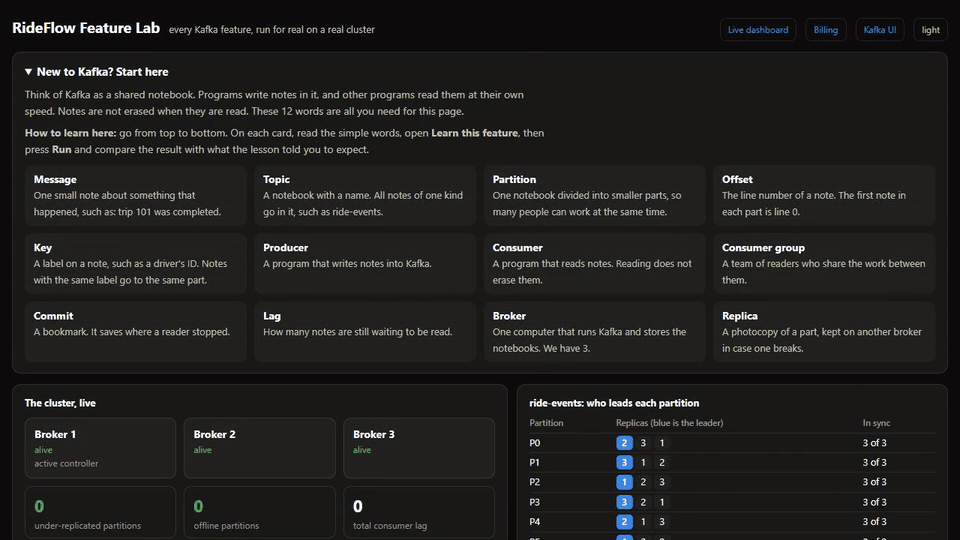

**[Watch the 1.5-minute tour in higher quality (MP4)](docs/demo/rideflow-tour.mp4)**

## Table of contents

- [Features](#features)
- [Architecture](#architecture)
- [Tech stack](#tech-stack)
- [Prerequisites](#prerequisites)
- [Getting started](#getting-started)
- [Verify the installation](#verify-the-installation)
- [Usage](#usage)
- [What the Feature Lab covers](#what-the-feature-lab-covers)
- [Optional full stack](#optional-full-stack)
- [Project structure](#project-structure)
- [Ports](#ports)
- [How the pipeline stays correct](#how-the-pipeline-stays-correct)
- [Troubleshooting](#troubleshooting)
- [Limitations](#limitations)
- [Security notice](#security-notice)

## Features

- **Real cluster:** 3 KRaft brokers, 3 copies of each partition, and no ZooKeeper
- **Feature Lab:** 50 runnable features, each with a plain-English lesson and pass or fail checks
- **Exactly-once billing:** invoices, totals and offsets commit in one Kafka transaction
- **State that survives restarts:** statistics are restored from a compacted topic
- **Failure handling:** a dead letter topic for broken messages, and automatic broker failover
- **Live views:** throughput, lag, partitions, and a step-by-step trace of one message
- **Self-test:** one command that runs every feature and reports the result

## Architecture

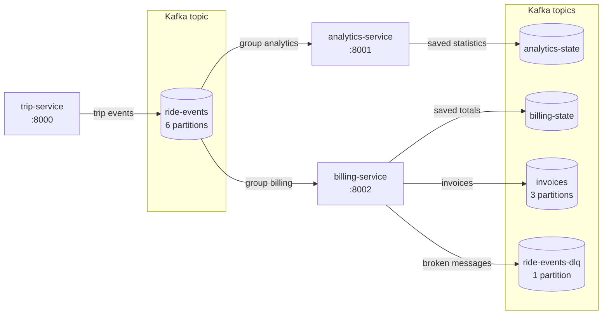

The services never call each other. They only communicate through Kafka.

- **Cluster:** `kafka-1`, `kafka-2` and `kafka-3`, with replication factor 3 and `min.insync.replicas` 2
- **Feature Lab:** `lab-service` on port 8003 runs every feature against the same cluster
- **Kafka UI:** `kafka-ui` on port 8080 lets you browse topics, partitions and consumer groups

### How one message travels

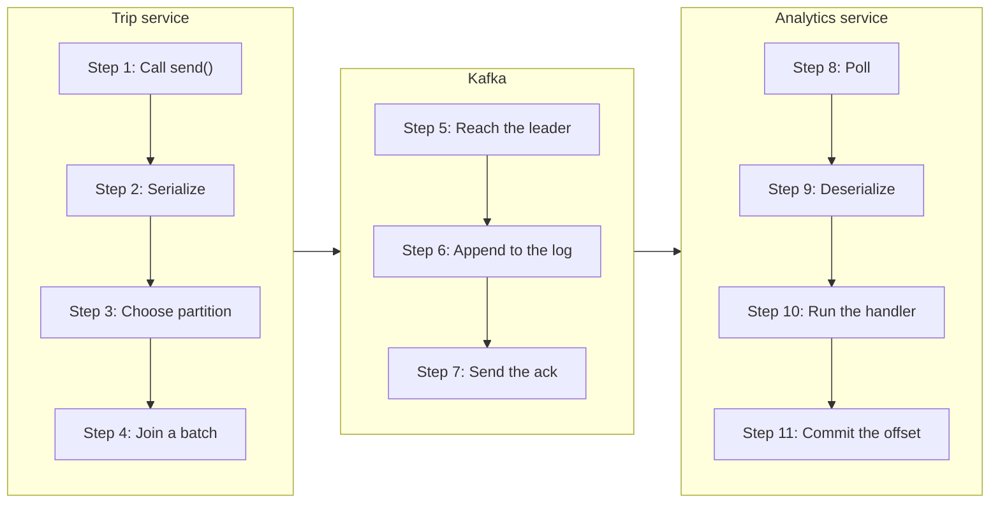

## Tech stack

| Area | Technology |
|---|---|
| Message broker | Apache Kafka 4.3.1 in KRaft mode |
| Services | Python 3.13, FastAPI, aiokafka 0.15 |
| Deployment | Docker Compose, with pinned versions |
| Kafka admin UI | Kafbat UI |
| Optional tools | Schema Registry, Kafka Connect, MirrorMaker 2, Prometheus, Grafana |

## Prerequisites

- [Docker Desktop](https://www.docker.com/products/docker-desktop/), or Docker Engine with Compose v2
- At least 4 GB of memory available to Docker
- Git

Python is not required on your machine, because everything runs in containers.

## Getting started

```bash
git clone https://github.com/Tareq612625/rideflow-kafka.git
cd rideflow-kafka
docker compose up -d --build
```

The first start downloads images and can take several minutes. When it finishes, open:

| Address | Description |
|---|---|
| <http://localhost:8003> | **Feature Lab, start here** |
| <http://localhost:8001> | Live dashboard |
| <http://localhost:8002> | Billing dashboard |
| <http://localhost:8080> | Kafka UI |
| <http://localhost:8000/docs> | Trip service API |

To stop everything:

```bash
docker compose down      # keeps your messages
docker compose down -v   # also deletes all stored messages
```

## Verify the installation

```bash
docker compose exec lab-service python -m app.selftest
```

This runs every feature and prints `PASSED`, `FAILED` or `SKIPPED` for each one, followed by a
summary. The four Ecosystem features show as skipped unless the full stack is running.

To run only some features:

```bash
docker compose exec lab-service python -m app.selftest --only keys,acks
```

## Usage

### Learn or present with the Feature Lab

1. Open <http://localhost:8003>.
2. Read **New to Kafka? Start here** for the 12 words you need.
3. Work through the numbered sections from top to bottom.
4. On each card, open **Learn this feature**, press **Run**, and compare the result with the lesson.
5. Press **Run everything** to run all the features in order.

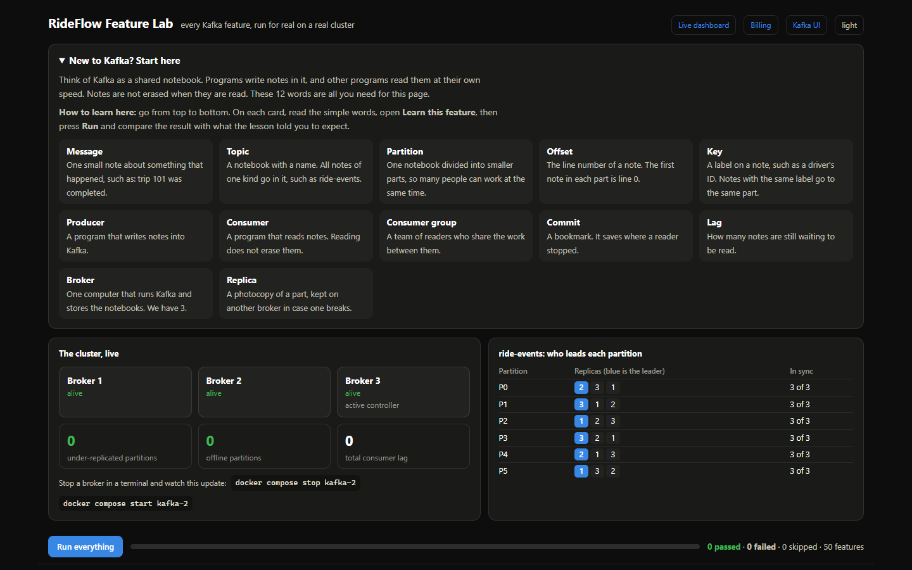

Each card explains the feature in simple words, gives an everyday example and a short lesson, then
shows the real result from the cluster:

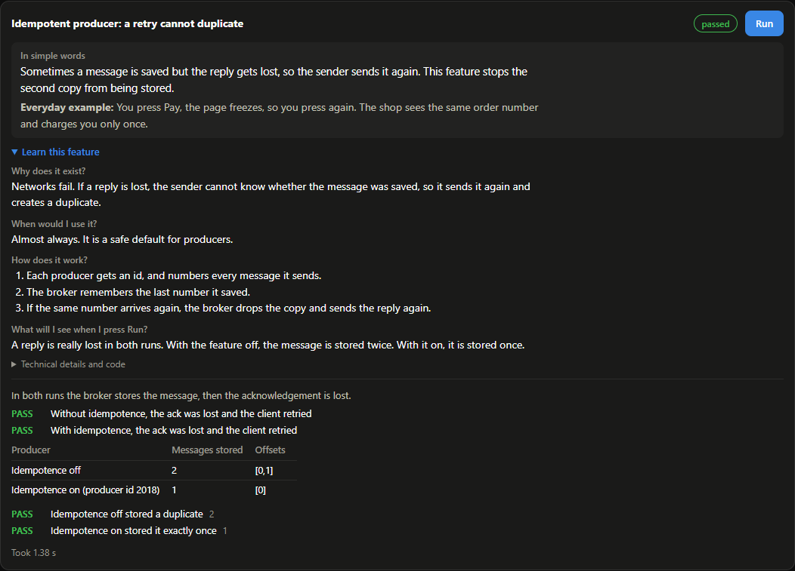

### Watch the live pipeline

On the dashboard at <http://localhost:8001>:

- Press **Blast 10,000** to watch throughput and consumer lag.
- Press **Trace one message** to follow one real message through 11 steps.
- Press **Send a broken message**, then open the billing page to see it parked in the dead letter topic.
- Click any row in the live stream to read that message back from Kafka.

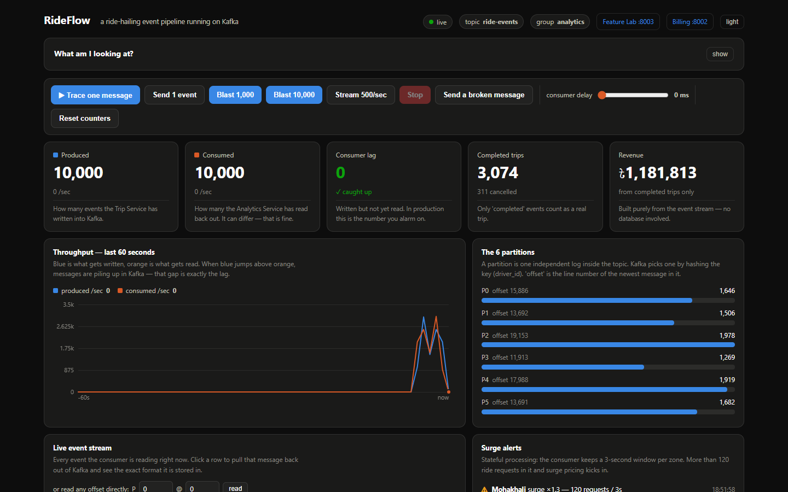

**Trace one message** shows the real key, partition and offset of one event at each step:

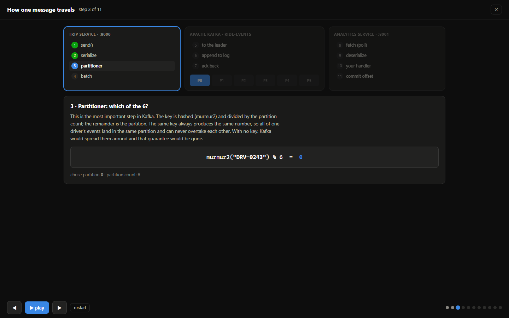

The billing page at <http://localhost:8002> reads the same events and turns completed trips into invoices:

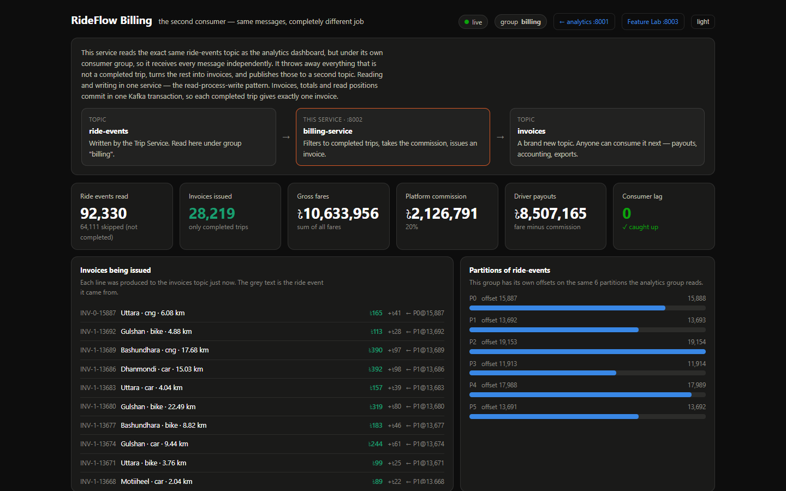

### Browse Kafka directly

Kafka UI at <http://localhost:8080> shows the topics, partitions, consumer groups and messages:

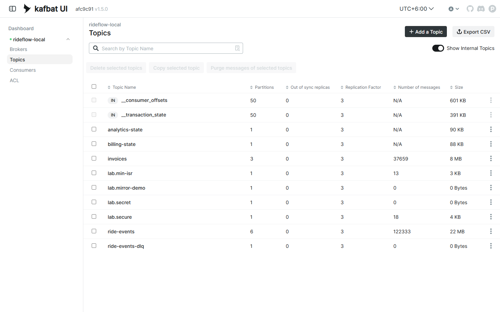

### Experiment: stop a broker

In the Feature Lab, run **Survive a broker failure**. While it runs:

```bash
docker compose stop kafka-2
```

Leaders move on the cluster panel, and the test still passes with nothing lost:

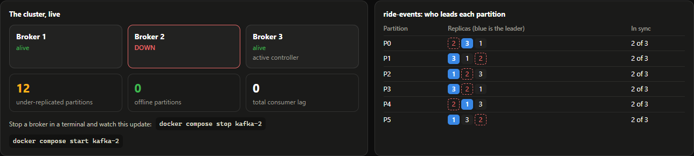

While the broker is down, run **min.insync.replicas refuses unsafe writes** to see an unsafe write
refused. Then:

```bash
docker compose start kafka-2
```

### Experiment: crash a service

Press **Blast 10,000** on the dashboard, then immediately run:

```bash
docker kill billing-service
docker start billing-service
```

Run **Audit the real billing pipeline** in the Feature Lab. Every completed trip still has exactly
one invoice.

### Experiment: watch lag grow and drain

Set **consumer delay** to `1 ms` and press **Blast 10,000**. Lag climbs. Set the delay back to `0`
and watch it drain.

### Experiment: replay with a new consumer group

```bash
docker compose run --rm -e GROUP_ID=analytics-v2 -p 8010:8001 analytics-service
```

Open <http://localhost:8010>. The new group reads the topic from the beginning, while the original
group carries on untouched. Press `Ctrl+C` to stop it.

## What the Feature Lab covers

| Section | Features | Topics |
|---|---|---|
| Topics and messages | 8 | Admin API, partitions, offsets, keys, ordering, custom partitioner, headers, timestamps, size limits |
| Producers | 6 | acks, min.insync.replicas, batching, compression, idempotence, client quotas |
| Consumers | 13 | Groups, rebalancing, pub/sub, assignors, static membership, offset reset, delivery guarantees, seek, rewinding a group, pause and resume, lag, dead letter queue, retry topics |
| Transactions and exactly-once | 5 | Commit and abort, read_committed, exactly-once processing, pipeline audit, zombie fencing |
| Storage and retention | 5 | Segment files, retention, deleting records, compaction, control records |
| The cluster | 3 | Brokers and KRaft, replication and ISR, broker failover |
| Stream processing | 3 | Event-time windows, stream-table join, changelog state |
| Security | 3 | SASL login, ACL permissions, TLS encryption |
| Ecosystem | 4 | Schema Registry, Kafka Connect, MirrorMaker 2, Prometheus and Grafana |

## Optional full stack

This adds Schema Registry, Kafka Connect, a second cluster with MirrorMaker 2, Prometheus and
Grafana. It downloads about 3 GB of images and needs more memory.

```bash
docker compose --profile full up -d --build
```

Grafana is available at <http://localhost:3000>, with a ready-made RideFlow dashboard.

To stop only the extras and keep the main system running:

```bash
docker compose --profile full stop
docker compose up -d
```

## Project structure

```text
rideflow-kafka/
├── docker-compose.yml      the whole system, with pinned versions
├── trip_service/           producer: trips, bursts and broken messages
├── analytics_service/      consumer: statistics, surge alerts, main dashboard
├── billing_service/        consumer and producer: invoices, exactly-once processing
├── lab_service/            the Feature Lab
│   └── app/
│       ├── features/       one file per section, one function per feature
│       ├── easy.py         beginner explanations and everyday examples
│       ├── lessons.py      the lesson for each feature
│       └── selftest.py     runs every feature from the command line
├── monitoring/             Prometheus and Grafana settings
└── docs/                   screenshots and the tour video
```

To add a feature, write a function with `@feature(...)` in `lab_service/app/features/`, then add
its text to `easy.py` and `lessons.py`. It appears on the page automatically.

## Ports

| Port | Service | Stack |
|---|---|---|
| 8000 | Trip service | Default |
| 8001 | Analytics service | Default |
| 8002 | Billing service | Default |
| 8003 | Feature Lab | Default |
| 8080 | Kafka UI | Default |
| 9092, 9094, 9095 | Brokers 1, 2 and 3, from your machine | Default |
| 8081 | Schema Registry | Full |
| 8083 | Kafka Connect | Full |
| 9096 | Second Kafka cluster | Full |
| 9090 | Prometheus | Full |
| 3000 | Grafana | Full |

## How the pipeline stays correct

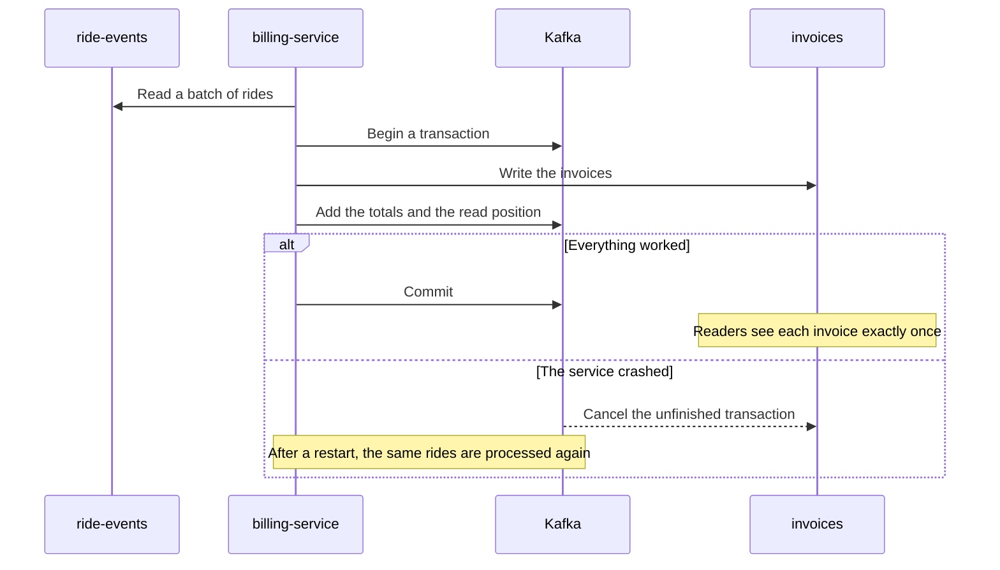

- **Exactly-once billing:** invoices, totals and read positions commit in one Kafka transaction.
  A crash cancels all of it, and the same rides are processed again.
- **Durable statistics:** each service saves its totals to a compacted topic in the same transaction
  as its offsets, the way Kafka Streams keeps state.
- **Ordered trips:** bursts send requested, accepted, then completed or cancelled, with the driver
  as the key, so the events of one trip stay in order.
- **Event-time surge alerts:** alerts use the time inside each event, so replaying old data raises
  no false alarms.
- **Broken messages never stop the stream:** billing parks them in a dead letter topic, and
  analytics counts them and moves on.

Anyone reading the `invoices` topic must use `isolation_level="read_committed"`. Otherwise they
also see messages from cancelled transactions.

## Troubleshooting

| Problem | Solution |
|---|---|
| A port is already in use | Stop whatever is using it, or change the left-hand port in `docker-compose.yml` |
| Start-up is very slow | Give Docker more memory. `kafka-init` starts a Java process for each step |
| A service cannot reach Kafka | Check `docker compose ps`, and wait until all three brokers show `healthy` |
| A Lab feature fails after stopping a broker | Run `docker compose start kafka-2`, then wait for under-replicated partitions to reach 0 |
| You want a completely clean start | Run `docker compose down -v`, then `docker compose up -d --build` |

To see what a service is doing:

```bash
docker compose ps
docker compose logs -f billing-service
```

To inspect Kafka directly:

```bash
docker exec kafka-1 /opt/kafka/bin/kafka-topics.sh --bootstrap-server localhost:29092 --describe --topic ride-events
docker exec kafka-1 /opt/kafka/bin/kafka-consumer-groups.sh --bootstrap-server localhost:29092 --describe --group analytics
```

In Git Bash on Windows, run `export MSYS_NO_PATHCONV=1` first, or the `/opt/kafka` paths are rewritten.

## Limitations

- **Kafka Streams** is a Java library, so the Lab shows the same ideas in Python.
- **Share groups** and **cooperative rebalancing** are not supported by aiokafka, the Python client used here.
- **Tiered storage** needs cloud storage, and **mutual TLS** is not set up. TLS here encrypts the
  connection and verifies the broker only.
- Each stateful service is designed to run as a single instance per group id.

## Security notice

This project is for local learning and demonstration only. The passwords, the self-signed
certificate and the no-login listeners are demo values. Do not expose these ports to a network,
and do not use this configuration in production.
